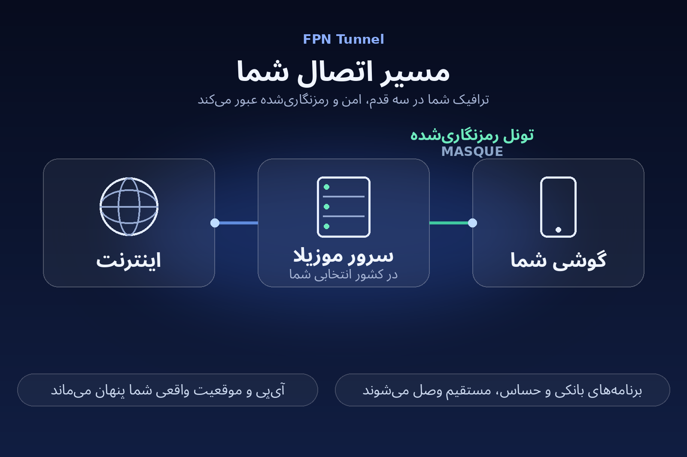

# FPN Tunnel for Android

**Use the Mozilla VPN / Firefox Private Network subscription you already paid for — on any Android phone, from anywhere, including networks that filter it.**

[](LICENSE)
[](https://github.com/AlienBoy69/fpn-tunnel-android/releases)
[](#requirements)
[](https://github.com/AlienBoy69/fpn-tunnel-android/stargazers)

A whole-phone **Firefox Private Network** (Mozilla's FPN / Mozilla VPN
subscription) client for Android in a **single APK** — no Termux, no Node,
no root, no laptop. Sign in with your own Firefox account inside the app,
pick an exit country (or let **Auto** pick for you), and the whole phone
routes through Mozilla's MASQUE proxies.



> **Unofficial.** Not affiliated with Mozilla. Use it with your own paid
> Firefox Private Network / Mozilla VPN subscription. Mozilla can change
> or close the underlying service at any time.

## Why this exists

Mozilla sells a perfectly good proxy network — Firefox Private Network /
Mozilla VPN, with MASQUE exits in 33 countries — but if you live outside
the supported regions there is no official way to use the subscription
you paid for on an Android phone: the official apps are region-gated,
and the desktop clients don't help a phone.

FPN Tunnel is the missing client. It signs in with **your own** Firefox
account, mints proxy passes from your own subscription, and routes the
whole phone through Mozilla's own MASQUE servers. There is no middleman,
no third-party server, and no account sharing — the session never leaves
your device, and the app talks only to Mozilla endpoints.

It was built in Iran, for exactly the conditions users there deal with:
filtered and unreliable DNS, gateways that fail in ways simple probes
can't see, and long routes to overseas exits. That is why connecting is
built around **real connection health checks**, not guesswork — see
Smart Connect below.

## What's new in 4.2.0

- ⚡ **Smart Connect (Auto by default)** — on connect, the app races
  *real* MASQUE CONNECT health dials across nearby countries and keeps
  the first exit that actually works. No more dead picks on filtered
  networks.
- 🩺 **Connection Doctor** — if a connection fails, the app diagnoses
  itself: sign-in, network, proxy pass, a real health dial, and DNS
  sinkhole checks, then attempts repairs in order (refresh the pass →
  switch server → fall back to Auto → restart the engine) and tells you
  what happened in plain language, with a stable reason code (E1–E7).
- 🔑 **Native sign-in (beta)** — email + password in the app's own form,
  no browser or WebView, implementing Mozilla's onepw protocol
  (including the v2 credential upgrade), email-code and TOTP
  verification, and Password Manager autofill. The classic WebView
  sign-in remains as a fallback — and is the only place "Sign in with
  Google" exists, because Google federation lives inside Mozilla's own
  web page.
- 🔁 **Connect-health failover** — a gateway that starts answering 5xx
  is quarantined and the app fails over to another country on its own
  (the fix for a real incident where one gateway broke every connection
  for a minute while looking perfectly healthy to TCP probes).
- 🦊 **A fox that glows** — the connect button is a low-poly fox that
  breathes and sways while connecting and glows when you're connected.
- Plus: auto-connect on app open and after boot, a Quick Settings tile,
  live per-session / today / all-time usage counters, and optional
  root-mode extras on rooted phones.

## Features

| | |
|---|---|
| 📦 **One APK, nothing else** | The proxy engine is an original Java implementation inside the app |
| 🌍 **Whole-phone tunnel** | Every app uses the VPN slot, not just a browser |
| 🗺️ **33-country picker + Auto** | Switch exit country live; Auto races real health dials |
| 🔀 **Split tunneling** | Banking and other chosen apps stay on the direct connection |
| ♻️ **Self-healing** | A watchdog rebuilds a dead engine or tunnel in place; the Doctor repairs sick connections |
| 📊 **Real usage numbers** | Live session rate, today and all-time totals — measured on your device (the plan is Unlimited; Mozilla publishes no quota, so the app invents none) |
| ⬆️ **Safe self-updates** | In-app updates download only from this repo and install only if the package name **and signing certificate** match the installed app |
| 🛡️ **Hardened path** | Upstreams resolved over DNS-over-HTTPS (raced resolver set); TLS validated against the system store with a bundled Mozilla root store fallback |
| 🔐 **Optional biometric lock** | Seal the stored session behind your fingerprint / lockscreen |
| 🧑‍💻 **Root mode (optional)** | On rooted phones: silent self-updates, a Doctor leak test, battery-whitelist — every root feature is opt-in; the unrooted app is complete |

## Requirements

- A **Firefox account with an active FPN / Mozilla VPN subscription**
  (the app cannot create one for you).
- **Android 10 or newer** for the current release. (An Android 7.1+
  build is in testing for older devices.)

## Download & install

Grab **`FpnTunnel.apk`** from the
[Releases](https://github.com/AlienBoy69/fpn-tunnel-android/releases)
page, install it, and follow the quick start below.

**About Android's install warnings:** any APK installed from outside
the Play Store shows Android's standard "unknown source" prompt — that
one is normal and appears for every sideloaded app. What you should
*not* see is a "harmful app" verdict; the app is built to avoid the
things that trigger it: only 6 permissions (listed below), no dynamic
code loading, no SMS/contacts/location access, and one consistent
signing key across releases. Don't take our word for it — verify:

- the **SHA-256** printed on the release page matches your download, and
- the app is **open source and reproducibly buildable** (see
  [Build from source](#build-from-source)).

**Permissions (all of them):** `INTERNET`,
`FOREGROUND_SERVICE` + `FOREGROUND_SERVICE_SPECIAL_USE` (the VPN runs
as a foreground service), `REQUEST_INSTALL_PACKAGES` (self-updates —
signature-verified, see above), `RECEIVE_BOOT_COMPLETED`
(auto-reconnect after reboot, only if you were connected),
`USE_BIOMETRIC` (the optional session lock).

**Persian step-by-step guide (راهنمای فارسی):** [docs/guide-fa.md](docs/guide-fa.md)

## Quick start

1. **Install** the APK and open **FPN Tunnel**.
2. **Sign in** with your Mozilla email + password in the app's form
   (beta), or use the web sign-in link below it — required if your
   account uses Google sign-in. One-time: the app keeps the session.
3. Leave the country on **⚡ Auto** (recommended on filtered networks)
   or pick a country in the **Location** menu.
4. **Tap the fox** and grant the Android VPN permission once.
   The fox glows when the tunnel is up.

If anything fails, tap **Diagnose connection** — the Doctor will check,
try to repair it, and explain the result.

## Privacy

- **Your session stays on your device.** Sign-in material never leaves
  the phone except to Mozilla's own endpoints; an optional biometric
  lock encrypts it at rest.
- **Client-metadata minimization:** calls to Mozilla/Fastly APIs use a
  neutral `Accept-Language: en-US` and a generic user agent, and the
  native sign-in keeps your browser fingerprint out of the flow.
  Honest limit: like any VPN, the exit server necessarily sees your
  real source IP when you connect, and your subscription's country is
  Mozilla-side account data. This is minimization, not invisibility —
  and the docs will never claim otherwise.
- **Anonymous error reports (optional, on by default):** if the app
  crashes or the Doctor finds a failure, a small report — app version,
  Android version, device model, the error code, and a sanitized log
  tail (emails, tokens and IPs stripped) — is queued and sent *through
  the tunnel* to the maintainer's report inbox, so your real IP never
  reaches it directly. No account data, no device ID. Turn it off any
  time in Settings; public builds ship with the reporting endpoint
  unconfigured (disabled) unless the builder provides one.
- **Shareable diagnostics** stay manual: one tap composes a sanitized
  bundle you send through any app you choose.

## How it works

```
┌─────────────┐   VpnService (hev-socks5-tunnel)   ┌──────────────────┐
│  all apps   │ ─────────────────────────────────▶ │  in-app engine   │
│  (minus     │        TUN, IPv4 only              │  proxy on        │
│  exclusions)│                                    │  127.0.0.1:11080 │
└─────────────┘                                    └────────┬─────────┘
                                                            │ TLS (CONNECT
                                                            │  + proxy pass)
                                                  ┌─────────▼─────────┐
                                                  │ Mozilla MASQUE    │
                                                  │ *.m1.fastly-      │
                                                  │ masque.net:2499   │
                                                  └───────────────────┘
```

The engine mints short-lived proxy passes from your Firefox session
(FxA token → Guardian API), keeps one alive at all times, and forwards
the local SOCKS5/HTTP proxy through the selected country's MASQUE
server. Server selection probes **real CONNECT health** — a gateway
that accepts TCP but fails CONNECTs is detected, quarantined, and
replaced. A loopback control API on `127.0.0.1:11081` (`/status`,
`/country?c=XX`, `/countries`) connects the UI's location picker to
the engine.

## Build from source

Needs a JDK and the Android SDK (build-tools 34 + platform android-34).
Point `ANDROID_TOOLCHAIN` at a directory containing `sdk/` and `jdk/`
(see the top of `build.sh`), then:

```sh
./build.sh   # downloads the hev AAR + the Mozilla root bundle, signs locally
```

The signing key is generated locally on first run (`keys/`, gitignored).
Output: `build/out/FpnTunnel.apk`.

## Known limitations

- Mozilla's MASQUE proxies refuse raw-IP destinations and some ports
  (e.g. FCM 5228) — push notifications for some apps can lag, and
  direct-IP connections (some Telegram traffic) fail by Mozilla's
  policy, for every FPN user.
- Native sign-in is **beta**: the protocol is implemented in full and
  the key derivation is byte-verified, but Mozilla's stage edge refuses
  scripted end-to-end logins, so the first full verification is a real
  account sign-in. The WebView fallback is fully working.
- Android may drop the VPN permission when the app is updated; if
  Connect stops working after an update, open the app and tap Connect
  again (re-granting if asked).

## Legacy: Termux engine (v1)

The `engine/` folder keeps the original Node/Termux variant: a separate
engine process (`run-fpn.mjs`) driven by a session extracted from
Firefox, with the app as a thin tunnel shell. It still works, but the
single-APK build above is the supported path.

## Credits

FPN Tunnel is an independent implementation, written for this
project. The FPN/MASQUE protocol behaviour was informed by the
open-source [foxhole](https://github.com/DierCodes/foxhole) project
(MIT), and the TUN forwarder is
[hev-socks5-tunnel](https://github.com/heiher/hev-socks5-tunnel) (MIT).

## License

MIT — see [LICENSE](LICENSE).
